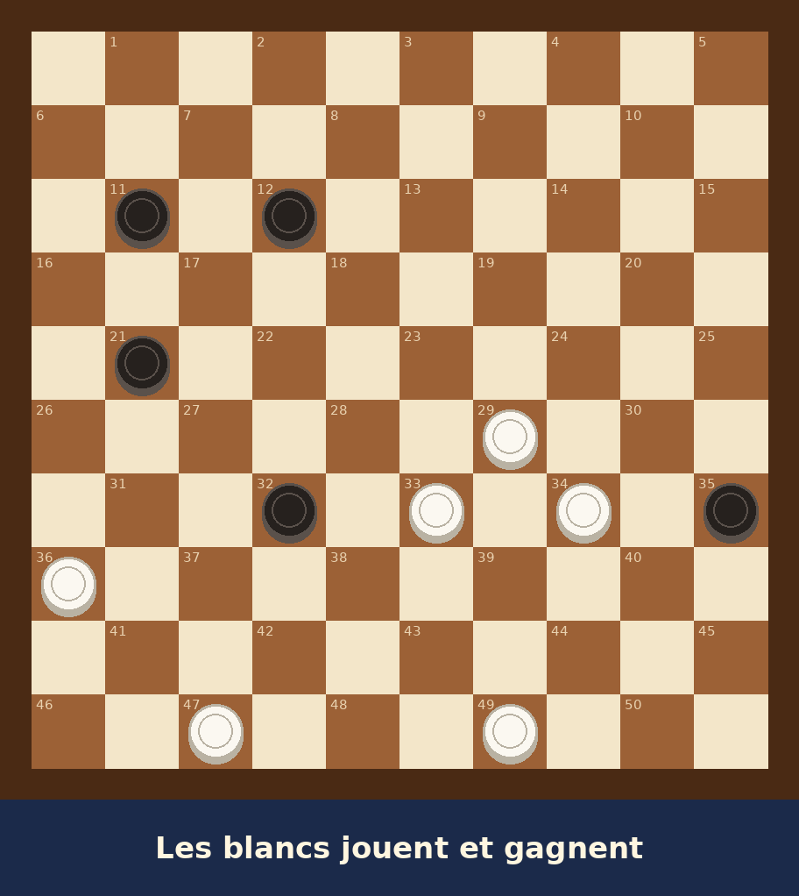

# S01E01 · L'homme au damier

**Durée visée :** 1 min 45 · **Format :** 9:16 · **Statut :** brouillon v0.1 (le pilote)

**La question de l'épisode :** Léo va-t-il trouver le coup ?

**La position au tableau :** `s01e01` dans [outils/positions.py](../outils/positions.py), vérifiée par
programme. Les blancs jouent 33-28 : ils donnent un pion, les noirs sont **obligés** de prendre, puis
les blancs raflent quatre pions et gagnent. C'est le seul coup gagnant sur les 9 possibles. La
solution n'est montrée qu'à l'épisode 2.

---

## Le découpage

| # | Temps | Image | Son et voix |
|---|---|---|---|
| 1 | 0:00 – 0:05 | Noir, puis un pion qui claque en très gros plan. Texte : *« Nord de la France. Un lundi matin. »* | Tic-tac. **CLAC !** **Narrateur :** « Dans une petite ville du Nord, un garçon de 10 ans s'ennuyait ferme… » |
| 2 | 0:05 – 0:09 | Carton-titre : *Kaze, le vent du damier · Épisode 1 · L'homme au damier* | Jingle de 3 secondes |
| 3 | 0:09 – 0:16 | La classe de CM2, panoramique lent. Léo, le menton dans la main, regarde par la fenêtre | Ambiance de classe. **Léo (pensée) :** « Lundi. Dictée. Calcul. Et ensuite… » |
| 4 | 0:16 – 0:22 | La porte s'ouvre. À contre-jour, un homme avec un grand damier sous le bras | **Madame Delcourt :** « Les enfants, je vous présente mon mari. Monsieur Armand va vous apprendre… le jeu de dames. » |
| 5 | 0:22 – 0:27 | Léo bâille de façon exagérée (goutte comique). Plan sur Armand : ses lunettes brillent d'un reflet blanc et il sourit | **Léo (tout bas) :** « Les dames ? C'est un jeu de vieux… » |
| 6 | 0:27 – 0:37 | Armand accroche le damier au tableau. Montage rapide de ses mains qui posent les pions | **CLAC, CLAC, CLAC !** **Armand :** « Aujourd'hui, pas de cours. Juste une question. » |
| 7 | 0:37 – 0:45 | **Le diagramme exact** de la position, plein écran | **Armand :** « Les blancs jouent… et gagnent. Qui trouve ? » |
| 8 | 0:45 – 0:52 | Silence. Plans rapides : des élèves perplexes, l'horloge murale, une mouche sur la vitre | Tic-tac de l'horloge. **Narrateur :** « Personne ne trouvait. » |
| 9 | 0:52 – 1:02 | Léo jette un œil, par défi. Zoom sur son œil : le damier s'y reflète, une étincelle | **Léo (pensée) :** « Pff, c'est facile, il suffit de… Non. Si je pousse là, il me prend… » |
| 10 | 1:02 – 1:15 | **Le premier plongeon :** la classe se dissout, ciel étoilé, Léo debout sur le damier infini. Un pion blanc avance tout seul vers les noirs… et un pion noir le prend | *Whoosh*, vent. **Léo :** « Il… il le donne ?! » |
| 11 | 1:15 – 1:23 | Retour en classe. Léo a les yeux écarquillés, une goutte de sueur sur la tempe | **Léo (pensée) :** « Pourquoi il le donnerait… à moins que… » |
| 12 | 1:23 – 1:30 | Léo lève lentement la main. Toute la classe se retourne vers lui | **Armand :** « Oui, jeune homme ? » **Léo :** « Je… je crois que je vois. » |
| 13 | 1:30 – 1:35 | **Freeze final :** image figée, virée sépia-rouge, Léo la main levée. Texte *« À suivre… »* | Musique du « À suivre » |
| 14 | 1:35 – 1:45 | La position revient en petit, avec un point d'interrogation | **Narrateur :** « Qu'a vu le petit Léo ? Pourquoi donner un pion pour gagner ? Ne manquez pas le prochain épisode : *Les pions qui bougent tout seuls* ! » |

**Texte en description ou à l'écran final :** *« Et toi, tu as trouvé ? Réponds en commentaire.
Solution dans l'épisode 2 ! »* Le problème au tableau devient un jeu pour les spectateurs.

## Les répliques à enregistrer

| Réplique | Personnage | Texte |
|---|---|---|
| r01 | Narrateur | « Dans une petite ville du Nord, un garçon de 10 ans s'ennuyait ferme… » |
| r02 | Léo (pensée) | « Lundi. Dictée. Calcul. Et ensuite… » |
| r03 | Madame Delcourt | « Les enfants, je vous présente mon mari. Monsieur Armand va vous apprendre… le jeu de dames. » |
| r04 | Léo (tout bas) | « Les dames ? C'est un jeu de vieux… » |
| r05 | Armand | « Aujourd'hui, pas de cours. Juste une question. » |
| r06 | Armand | « Les blancs jouent… et gagnent. Qui trouve ? » |
| r07 | Narrateur | « Personne ne trouvait. » |
| r08 | Léo (pensée) | « Pff, c'est facile, il suffit de… Non. Si je pousse là, il me prend… » |
| r09 | Léo | « Il… il le donne ?! » |
| r10 | Léo (pensée) | « Pourquoi il le donnerait… à moins que… » |
| r11 | Armand | « Oui, jeune homme ? » |
| r12 | Léo | « Je… je crois que je vois. » |
| r13 | Narrateur | « Qu'a vu le petit Léo ? Pourquoi donner un pion pour gagner ? Ne manquez pas le prochain épisode : *Les pions qui bougent tout seuls* ! » |

## Les images

Animatique complète (images, sous-titres, voix déjà enregistrées) :
[s01e01-animatique.json](s01e01-animatique.json), à monter avec `python3 outils/animatique.py`.

| Plan | Image | Origine |
|---|---|---|
| 1 | [p01-clac.jpg](../visuels/s01e01/p01-clac.jpg) | IA |
| 2 | [0-affiche.jpg](../visuels/concepts/0-affiche.jpg) + titre | IA |
| 3 | [p03-ennui.jpg](../visuels/s01e01/p03-ennui.jpg) | IA, références Léo + classe |
| 4 | [p04-porte.jpg](../visuels/s01e01/p04-porte.jpg) | IA, références Armand + classe |
| 5 | [p05a-baillement.jpg](../visuels/s01e01/p05a-baillement.jpg), [p05b-lunettes.jpg](../visuels/s01e01/p05b-lunettes.jpg) | IA |
| 6 | [p06-mains.jpg](../visuels/s01e01/p06-mains.jpg) | IA, régénérée puis recadrée (des pions étaient sur des cases claires) |
| 7 | [plateau.png](../visuels/positions/s01e01/plateau.png) | **Programme (exact)** |
| 8 | [p08a-eleves.jpg](../visuels/s01e01/p08a-eleves.jpg) | IA + **damier mural exact incrusté** |
| 8 | [p08b-horloge.jpg](../visuels/s01e01/p08b-horloge.jpg) | IA, pancarte en japonais effacée |
| 9 | [p09-oeil.jpg](../visuels/s01e01/p09-oeil.jpg) | IA |
| 10 | [p10-damier-mental.jpg](../visuels/s01e01/p10-damier-mental.jpg) | IA (plan d'ambiance) |
| 11 | [p11-sueur.jpg](../visuels/s01e01/p11-sueur.jpg) | IA |
| 12-13 | [p12-main-levee.jpg](../visuels/s01e01/p12-main-levee.jpg) | IA + **damier mural exact incrusté** ; image figée sépia-rouge au montage |
| 14 | [plateau.png](../visuels/positions/s01e01/plateau.png) | **Programme (exact)** |

Les images brutes de l'IA sont gardées dans [visuels/s01e01/brut/](../visuels/s01e01/brut/).
