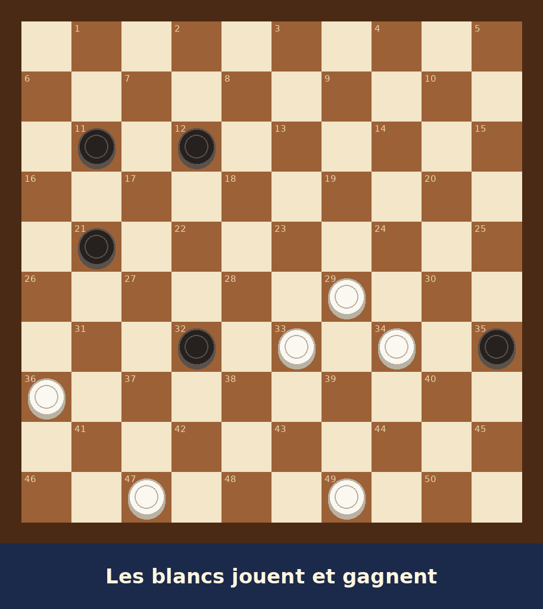

# S01E02 · Les pions qui bougent tout seuls

**Durée visée :** 1 min 50 · **Format :** 9:16 · **Statut :** brouillon v0.1

**La question de l'épisode :** pourquoi donner un pion pour gagner ?

**Le mot de l'épisode :** la **prise obligatoire**. Aux dames, quand on peut prendre, on doit
prendre. C'est ce qui permet de forcer l'adversaire à tomber dans un piège.

**La position :** `s01e01` (vérifiée). La solution complète :

| Coup | Ce qui se passe | Forcé ? |
|---|---|---|
| 33-28 | Les blancs donnent un pion | Non : c'est l'idée de Léo |
| 32x23 | Les noirs sont obligés de prendre | Oui, seul coup légal |
| 29x18x7x16x27 | La rafle : quatre pions d'un coup | Oui |
| 35-40 | Le dernier pion noir n'a qu'un coup | Oui |
| 34x45 | Il se fait prendre : les noirs n'ont plus rien | Oui |

Bilan pour les enfants : **les blancs ont donné un pion et en ont pris cinq.**

---

## Le découpage

| # | Temps | Image | Son et voix |
|---|---|---|---|
| 1 | 0:00 – 0:08 | **Précédemment :** Armand à la porte (S01E01 p04), le problème au tableau, Léo la main levée (image figée) | **Narrateur :** « Précédemment : un homme est entré dans la classe de Léo, avec un damier sous le bras… » |
| 2 | 0:08 – 0:12 | Carton-titre ([p02-titre](../visuels/s01e01/p02-titre.jpg)) : *Épisode 2 · Les pions qui bougent tout seuls* | Jingle |
| 3 | 0:12 – 0:18 | Armand, bras croisés, devant le tableau | **Armand :** « Je t'écoute, jeune homme. » |
| 4 | 0:18 – 0:24 | Léo debout à sa place, un peu tremblant | **Léo :** « Les blancs… donnent un pion. Trente-trois… vingt-huit. » |
| 5 | 0:24 – 0:29 | Les élèves éclatent de rire (caméra à la place du maître) | **Un élève :** « Il donne un pion ! N'importe quoi ! » |
| 6 | 0:29 – 0:33 | Armand, impassible, ses lunettes brillent | **Armand :** « Et ensuite ? » |
| 7 | 0:33 – 0:37 | Gros plan : Léo ferme les yeux | Le bruit de la classe s'éteint. *Whoosh.* |
| 8 | 0:37 – 0:49 | **Damier mental (animation exacte) :** 33-28, puis le pion noir saute : 32x23. Texte à l'écran : **PRISE OBLIGATOIRE** | **Léo (pensée) :** « Aux dames, prendre, c'est obligatoire… Alors il est OBLIGÉ de prendre ! » |
| 9 | 0:49 – 1:03 | **Damier mental (animation exacte) :** la rafle 29x18x7x16x27, quatre bonds en zigzag, une bourrasque, l'écharpe qui claque, chaque pion noir qui éclate | **Léo :** « Et là… je prends tout ! Un… deux… trois… quatre ! » **CLAC ×4** |
| 10 | 1:03 – 1:11 | **Damier mental (animation exacte) :** 35-40, puis 34x45. Le damier se vide de ses pions noirs | **Léo (pensée) :** « Le dernier pion noir n'a qu'un seul coup… et je le prends. » |
| 11 | 1:11 – 1:19 | Retour en classe : **le diagramme exact** avec les flèches de la solution | **Narrateur :** « Les blancs ont donné un pion… et ils en ont pris cinq ! » |
| 12 | 1:19 – 1:24 | Silence. Toute la classe regarde Léo, bouche bée | — |
| 13 | 1:24 – 1:30 | Gros plan : Armand sourit sous sa moustache | **Armand :** « Samedi, il y a club. » |
| 14 | 1:30 – 1:34 | Léo, radieux | Petit thème héroïque |
| 15 | 1:34 – 1:42 | Le soir, la cuisine des Vermeulen. Antoine pose un damier sur la table en formica, sourire en coin | **Antoine :** « Toi aussi ? Voyons si tu tiens deux minutes. » |
| 16 | 1:42 – 1:45 | **Image figée** sépia-rouge, *« À suivre… »* | Accord du « À suivre » |
| 17 | 1:45 – 1:52 | Le carton-titre | **Narrateur :** « Léo tiendra-t-il deux minutes face à son grand frère ? Ne manquez pas le prochain épisode : *Le coup secret* ! » |

## Les répliques à enregistrer

| Réplique | Personnage | Texte |
|---|---|---|
| r01 | Narrateur | « Précédemment : un homme est entré dans la classe de Léo, avec un damier sous le bras… » |
| r02 | Armand | « Je t'écoute, jeune homme. » |
| r03 | Léo | « Les blancs… donnent un pion. Trente-trois… vingt-huit. » |
| r04 | Un élève | « Il donne un pion ! N'importe quoi ! » |
| r05 | Armand | « Et ensuite ? » |
| r06 | Léo (pensée) | « Aux dames, prendre, c'est obligatoire… Alors il est OBLIGÉ de prendre ! » |
| r07 | Léo | « Et là… je prends tout ! Un… deux… trois… quatre ! » |
| r08 | Léo (pensée) | « Le dernier pion noir n'a qu'un seul coup… et je le prends. » |
| r09 | Narrateur | « Les blancs ont donné un pion… et ils en ont pris cinq ! » |
| r10 | Armand | « Samedi, il y a club. » |
| r11 | Antoine | « Toi aussi ? Voyons si tu tiens deux minutes. » |
| r12 | Narrateur | « Léo tiendra-t-il deux minutes face à son grand frère ? Ne manquez pas le prochain épisode : *Le coup secret* ! » |

**Distribution proposée :** Léo = la compagne de l'auteur ; Armand et le narrateur = l'auteur ;
l'élève et Antoine (13 ans) = à décider (un ami du club ? la compagne avec une autre voix ?).

## Les images à produire

| Plans | Origine |
|---|---|
| 1, 2, 16, 17 | Réutilisées de l'épisode 1 (carton-titre, image figée) |
| 3, 4, 5, 6, 7, 12, 13, 14 | IA, avec les références de Léo, d'Armand et de la classe ; **plan de la classe** à respecter (élèves face au maître) |
| 15 | IA : il faut d'abord **dessiner Antoine** (fiche de référence) et la cuisine |
| 8, 9, 10 | **Moteur du damier mental** (animations exactes) ; le plan 8 réutilise l'animation du plan 10 de l'épisode 1 |
| 11 | **Diagrammes exacts** ([visuels/positions/s01e01/](../visuels/positions/s01e01/)) |

**À ajouter au moteur :** la rafle en plusieurs bonds (un arc par pion pris) et l'éclatement de
chaque pion pris.
